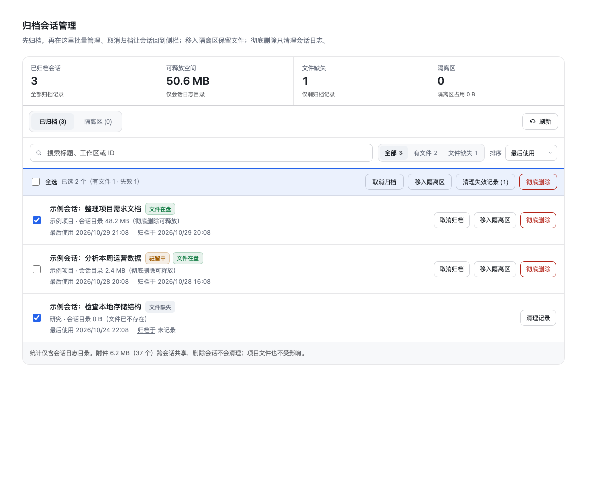
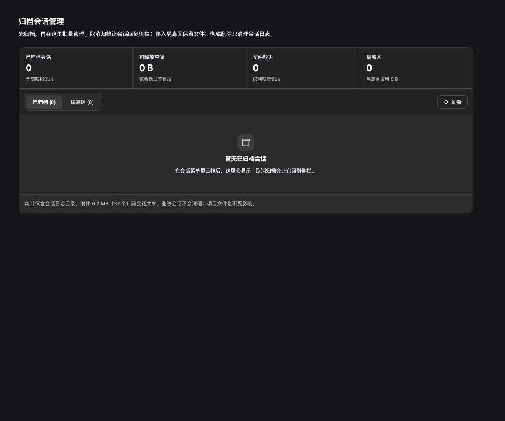
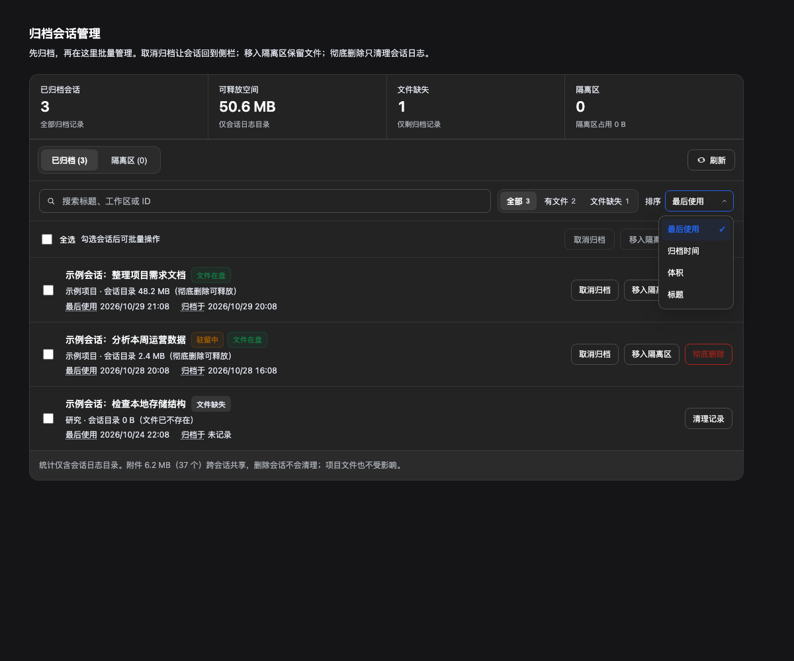

# dsh-archived-manager

[](https://github.com/chen1pengvincent/dsh-archived-manager/actions/workflows/test.yml)

> **DSH 插件 / DeepSeek Harness plugin** · 归档会话 · archived sessions · quarantine · retention

在 DSH 设置页管理已归档会话：**取消归档、移入可恢复隔离区、彻底删除会话日志**，并支持搜索、筛选、排序、批量恢复与隔离区自动清理。

[中文](#dsh-archived-manager) | [English](#english)

- **取消归档**：调用 DSH 原生 `unarchiveSession`，会话回到侧栏，文件原地保留。
- **移入隔离区（保留文件）**：会话目录整体移入 `~/.dsh/archived-manager/trash/<批次>/`，DSH 所有列表（含“显示已归档”）不再显示，文件保留、可恢复。
- **彻底删除**：只删除会话日志目录（不可恢复），同时清理归档 id 与工作区归属；项目文件与附件不受影响。
- **隔离区**：单条/批量恢复、单条/批量永久删除、清空；可选 7/30/90 天保留期（默认永不）。
- **批量与检索**：多选、全选当前筛选结果、搜索、状态筛选、按时间/体积/标题排序。
- **可诊断**：成功显示数量与释放体积，失败保留选中并列出标题与原因。
- **本地优先**：所有操作在本机 Host 内完成，无遥测、无外部网络请求；HTTP 接口只接受回环请求。

> 为什么“移入隔离区”不是简单取消归档：DSH 的“归档”本身已经是“隐藏 + 保留文件”。只从归档集合移除会让会话**重新出现在侧栏**，与本插件的目标相反。因此移入隔离区 = 把文件移出 `sessions/`，并从工作区账本解绑。

## 安装

**要求**：DSH Desktop 2.0.17+（内核 0.2.1-rc.2 实测），Node.js 20+。

界面语言优先跟随 DSH 的 **设置 → 通用 → 语言**；仅在 locale 服务不可用的旧版回退 `navigator.language`。中文界面显示“归档会话管理”，英文界面显示“Archived session manager”。

1. 打开 **设置 → 插件 → 安装**，填入 GitHub spec：
   ```
   github:chen1pengvincent/dsh-archived-manager#v0.2.4
   ```
2. 安装完成后**完全退出并重开 DSH**（⌘Q），再 `Cmd+Shift+R` 硬刷新页面。
3. 入口在「设置 → 归档会话」。

> 开发或本地修改时，也可以 clone 后安装本地链接：`link:/absolute/path/to/dsh-archived-manager`（把路径换成你的 checkout）。从 GitHub 安装是源码安装，没有额外构建步骤。

升级：把上面的 tag 换成新版本重新安装；卸载：设置 → 插件 → 卸载 `dsh-archived-manager`，重启。插件不直接手写 `workspace.json`；卸载后隔离区目录会保留，可手动删除。

## 使用

1. 打开设置 → **归档会话**。
2. 「已归档」页签每行显示：标题、工作区、**最后使用**、**归档于**、**会话目录体积（彻底删除可释放）**，以及状态徽章：
   - **文件在盘**：文件仍在磁盘。悬停解释：「取消归档会回到侧栏；移入隔离区会保留文件；彻底删除才清理日志」。
   - **文件缺失**：日志目录已不存在，只剩归档记录。悬停解释：「清理只删这条记录，不动任何文件」。
   - 运行中 / 驻留中同样有徽章；「最后使用」「归档于」的虚线标签可悬停看来源说明。
3. 支持**搜索**（标题 / 工作区 / ID）、**筛选**（全部 / 有文件 / 文件缺失）、**排序**（最后使用 / 归档时间 / 体积 / 标题）；全选只作用于当前可见结果。
4. 选择单个或批量，确认走**模态弹窗**（遮罩 + 面板，ESC / 点遮罩取消，初始焦点在面板）：
   - **取消归档**：调用 DSH 原生 `unarchiveSession`，会话回到侧栏，文件原地保留；与本体行为完全一致。
   - **移入隔离区**：只处理有文件的会话，文件移入隔离区（可恢复）；文件缺失的记录不受影响。
   - **彻底删除**：只处理有文件的会话，红底白字 + 勾选“我已知晓不可恢复”，显示数量与**将释放体积**；只清理会话日志目录。
   - **清理失效记录**：文件已不存在的归档记录单独走这个动作，明确“不会删除任何文件”。
   - 若所选记录全部文件缺失，「取消归档 / 移入隔离区 / 彻底删除」会被禁用并提示改用「清理失效记录」。
5. 「隔离区」页签：
   - 单条/批量**恢复**（文件移回原路径，重新挂到工作区）；
   - 单条/批量**彻底删除**（自定义红色模态 + 勾选，不可恢复）；
   - **清空隔离区**；
   - **隔离区自动清理**：保留期限 永不 / 7 / 30 / 90 天，默认**永不**；开启时二次确认，保存后立即清理过期条目。

## 界面布局



空状态也保留紧凑概况与范围说明：



自绘下拉打开态（非系统原生 select）：



- 顶部区：仅保留标题与说明，避免刷新按钮悬空。
- 工作台：概况、页签与刷新、检索/批量区、列表/空状态、保留策略、范围说明统一收拢在一个带分隔线的卡片内，形成明确区块。
- 概况区：数据就绪后显示 4 个紧凑指标（已归档会话 / 可释放空间 / 文件缺失 / 隔离区）；零数据也保留概况，不再只剩一个巨大虚线框。
- 页签与刷新：已归档 / 隔离区分段切换，刷新图标与文字放在同一工具条右侧。
- 控制区：搜索框、状态筛选、**自绘下拉**排序（不调用系统原生 `select`，带打开动画、键盘导航与选中态）；仅在搜索/筛选时显示“显示 X / Y”。
- 操作条：左侧全选与已选拆分统计，右侧取消归档 / 移入隔离区 / 清理失效记录 / 彻底删除；有选中时整条高亮。
- 列表区：每行标题 + 状态徽章、两行元信息（工作区/体积、最后使用/归档时间）、右侧三个短按钮。**两个时间各自成块、可自动换行，完整展示，不省略、不依赖 hover 提示**。
- 隔离区：独立的保留期限**自绘下拉**、批量恢复、批量删除、清空；时间同样完整展示。
- 范围说明：附件与删除范围只在数据就绪后显示，加载或首次失败时不展示假零值。
- 状态页：加载（旋转指示）、失败（错误卡片 + 重试）、空（图标 + 说明）、筛选无结果（清除筛选）。
- 响应式：<760px 指标 2×2，<860px 行操作移到下一行，<720px 搜索独占一行，<420px 指标单列；时间在窄屏自动换行，不截断。
- 确认统一为模态弹窗（遮罩 / ESC / 焦点圈定），危险动作红底白字。

## 可访问性与配色

- 工作台、指标与下拉菜单使用 DSH 内容表面 `bg-layer-1`，不再把弹层 `overlay` 的灰色当正文背景；弹窗仍保留 overlay 语义。
- 文字分为主文字、次级文字、三级提示三层；日间弱化色与强调色全部达到 WCAG AA，夜间次级文字/三级提示/选中蓝/危险红额外以约 7:1 以上为目标。
- 禁用按钮使用可读的三级提示色与弱边框，不再用“语义色 + 低透明度”掩盖文字。
- 字体沿用 DSH 系统字体：标题 18px、正文 12–13px、指标 22px、会话标题 14px、元信息 12px，兼顾中文与英文/数字。
- 详细调研、令牌和对比度见 [可访问性、配色与排版](docs/accessibility.md)；`test/theme.test.mjs` 会计算实际对比度并禁止 overlay 回潮。

## 安全设计

| 风险 | 对策 |
|---|---|
| 路径穿越 / 符号链接 | 只接受 UUID 形状的 id；目录由 `readdir` 精确匹配；`realpath` 后必须仍在 sessions 根内；manifest 的 `dir` 拒绝分隔符；删除/统计不跟随符号链接 |
| 越权删除 | 只允许删除 `archivedSessionIds` 里的会话；不在集合内直接拒绝 |
| 删到运行中的会话 | `agents.get(id).status === 'running'` 拒绝 |
| 并发重复点击 | Host 内串行队列；前端按钮在请求期间禁用 |
| 注册表写坏 | 只用 `unarchiveSession()` / `detachSession()` 公开 API，**从不手写 `workspace.json`**；取消归档与 DSH 本体走同一个原生方法 |
| CSRF | 仅回环地址 + 同源校验 + POST 必须带 `x-archived-manager: 1` 自定义头 |
| 误删 | 会话/隔离区/保留策略所有删除都必须勾选确认；批量显示数量与体积；恢复无需确认 |
| 文件缺失的悬空 id | 列表标记「文件缺失」（悬停解释），操作退化为“清理记录”（只清 id） |
| 定时提醒 | 移入隔离区 / 彻底删除 / 清理 / 隔离区删除前调用 `schedule.stopSessionTasks`，避免孤儿提醒 |
| 附件误解 | 体积只统计会话日志目录；界面明确说明附件跨会话共享、不随会话删除，当前附件总量单独展示 |
| 驻留会话 | 允许移入隔离区/删除（日志无打开 fd；归档闸门阻断其运行），但 UI 行可能到刷新/重启才消失 |

## 数据位置

- 隔离区：`<DSH_HOME>/archived-manager/trash/<ISO 时间戳>/`
  - 会话目录原样移动
  - `manifest.json` 记录 id、原路径、体积、标题、工作区、移入时间
- 归档时间：`<DSH_HOME>/archived-manager/archive-times.json`
  - DSH 只保存归档 id 集合、不保存时间；插件每 30 秒观测一次，新出现的 id 记首次观测时间。
  - **首次运行**时已存在的归档 id 一律记为 `null`（界面显示“未记录”），不会被误标成安装时间。
  - 取消归档 / 移入隔离区 / 彻底删除会移除对应记录，重新归档重新计时。
- 保留策略：`<DSH_HOME>/archived-manager/settings.json`（`trashRetentionDays`，0/7/30/90，默认 0）；Host 每 6 小时、启动 15 秒后各检查一次。
- 删除只影响 `<DSH_HOME>/sessions/`（以及隔离区）与 `workspace.json` 的归档集合；彻底删除/隔离区删除会顺带清理对应投影缓存。
- **附件**：`<DSH_HOME>/attachments/` 是内容寻址、跨会话共享的；插件只展示总量，不随会话删除。项目文件也不受影响。

## HTTP API（仅本机回环）

| 方法 | 路径 | 作用 |
|---|---|---|
| GET | `/archived-manager/list` | 已归档列表（含 `lastUsedAt` / `archivedAt` / 目录体积 / 附件总量）+ 隔离区条目 |
| POST | `/archived-manager/unarchive` `{ids}` | 取消归档（DSH 原生 `unarchiveSession`，文件原地保留） |
| POST | `/archived-manager/hide` `{ids}` | 移入隔离区（保留文件） |
| POST | `/archived-manager/purge` `{ids, confirm:"PURGE"}` | 彻底删除（仅会话日志） |
| POST | `/archived-manager/forget` `{ids}` | 仅清理文件已缺失的归档记录（有文件则拒绝） |
| GET | `/archived-manager/removed` | 隔离区条目 |
| POST | `/archived-manager/restore` `{items:[{batch,id}]}` | 从隔离区恢复 |
| POST | `/archived-manager/discard` `{items, confirm:"DISCARD"}` | 永久删除指定隔离区条目 |
| POST | `/archived-manager/empty-trash` `{confirm:"EMPTY"}` | 清空隔离区 |
| GET | `/archived-manager/settings` | 读取保留策略 |
| POST | `/archived-manager/settings/save` `{trashRetentionDays}` | 保存保留策略并清理过期条目 |
| GET | `/archived-manager/health` | 版本与 home |

## 测试

```bash
npm test
```

55 项测试，覆盖：列表/标题/体积、附件统计、移入隔离区与 manifest、运行中拒绝、非归档拒绝、彻底删除确认、取消归档、隔离区单条删除、保留策略与过期清理、定时提醒停止、恢复与路径校验（含 manifest 穿越）、悬空 id、清空隔离区、路由鉴权（回环/同源/自定义头/405/唯一路径）、客户端设置页注册/搜索/筛选/隔离区/保留策略/模态渲染、日夜主题与 WCAG 对比度。

## 已知限制

- 隔离区默认**不自动清理**（可在「隔离区」页签选择 7/30/90 天保留期）；也可以手动逐条删除或清空。
- 同一 `DSH_HOME` 只支持单实例；多实例并发时以 Host 内的串行队列为准，但文件移动仍可能受另一实例影响。
- 运行中的会话拒绝删除；请先停止该会话。
- 恢复后需要刷新页面或重启 DSH 才会在侧栏出现（宿主内存索引不会即时重建）。

## English

**dsh-archived-manager** is a [DSH (DeepSeek Harness)](https://github.com/deepseek-ai/deepseek-harness) plugin that adds an **Archived Sessions** page under **Settings**. It lets you:

- **Unarchive** with DSH's native `unarchiveSession` action; files stay in place and the session returns to the sidebar.
- **Move a session into a recoverable quarantine**; the session disappears from every DSH list but its files are kept.
- **Permanently purge session logs**, with an explicit checked danger confirmation; project files and shared attachments are not touched.
- **Restore** quarantine entries individually or in bulk, permanently delete selected entries, or empty the quarantine.
- **Search, filter, and sort** archived sessions; select all applies to the visible result set.
- **Auto-clean** quarantine entries after 7 / 30 / 90 days (off by default).
- See exactly how much session-log space can be released, plus the separate shared-attachment total.

All operations run locally in the DSH Host. There is no telemetry and no external network request; the HTTP endpoints accept loopback requests only and require a same-origin, custom-header request.

### Install

1. Open **DSH → Settings → Plugins → Install** and enter:
   ```
   github:chen1pengvincent/dsh-archived-manager#v0.2.4
   ```
2. Fully quit DSH (⌘Q), reopen it, then hard-refresh the page (`Cmd+Shift+R`).
3. Open **Settings → Archived Sessions**.

The UI follows DSH's **Settings → General → Language** selection and falls back to the browser locale only when the locale service is unavailable; Chinese DSH shows `归档会话管理`, English DSH shows `Archived session manager`.

Tested with DSH Desktop 2.0.17 / core 0.2.1-rc.2, Node.js 20+.

### Search keywords

DSH plugin, DeepSeek Harness plugin, archived sessions, session cleanup, session manager, quarantine, retention, Cordis, local-first, macOS.

### License

MIT. See [LICENSE](LICENSE).
