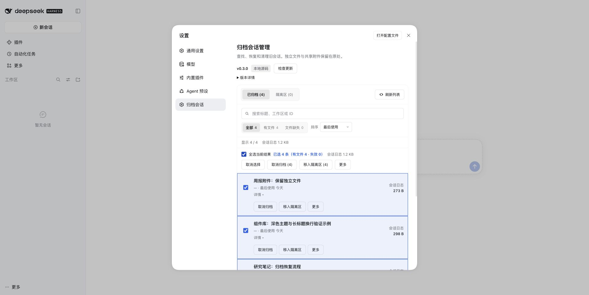
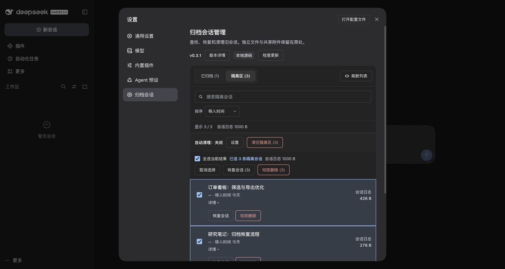

# dsh-archived-manager

[](https://github.com/chen1pengvincent/dsh-archived-manager/actions/workflows/test.yml)

> DeepSeek Harness（DSH）归档会话管理插件：原生取消归档、可恢复隔离区、彻底删除、批量选择、检索与保留策略。

[中文文档](#dsh-archived-manager) · [English](#english) · [Releases](https://github.com/chen1pengvincent/dsh-archived-manager/releases)

## 功能

- **取消归档**：调用 DSH 原生 `unarchiveSession`，会话回到侧栏，日志文件原地保留。
- **移入隔离区**：把已确认的会话数据移入插件隔离区；可从隔离区单独或批量恢复。
- **彻底删除**：经明确确认后永久删除会话日志；项目文件和共享附件不在删除范围内。
- **清理失效记录**：日志目录已不存在时，只移除归档记录，不触碰其他文件。
- **批量与检索**：单选、全选当前筛选结果，按标题/工作区/ID 搜索，按状态筛选，按时间、体积或标题排序。
- **隔离区保留策略**：永不自动清理，或保留 7 / 30 / 90 天；默认永不。
- **关联文件**：查看会话中已记录的生成、写入或修改文件的位置，并打开所在文件夹；会话工作区另设入口。
- **版本与手动更新**：显示页面、服务和安装版本；手动检查 GitHub 稳定版，通过独立控制页更新。源码链接只有在明确选择“切换为发布版”后才改变安装来源。
- **本地优先**：无遥测、无后台更新；只有手动检查或更新时访问本仓库 GitHub 发布信息和安装包。管理接口仅接受本机回环、同源且带自定义请求头的调用。

## 安装与升级

### 从 GitHub 安装（推荐）

1. 打开 **DSH → 设置 → 插件 → 安装**。
2. 输入以下 spec：

   ```text
   github:chen1pengvincent/dsh-archived-manager#v0.3.1
   ```

3. 安装后**完全退出并重新打开 DSH**，再硬刷新页面（macOS：`Cmd+Shift+R`）。
4. 打开 **设置 → 归档会话**。

v0.3.0 起可在归档会话页手动检查稳定版并更新。更新控制页会固定目标版本，在卸载前下载并校验安装包；旧插件卸载后，该页仍可展示安装结果，并在失败时提供重试或恢复入口。安装成功后按提示重新打开页面或重启 DSH。

更新期间请保持 DSH 运行。关闭控制页不会取消安装；若整个 DSH 进程在卸载后、安装完成前退出，请在宿主插件管理页使用目标版本的安装地址恢复。控制页会列出该地址。无需额外构建，也无需在本机单独安装 Node.js；Node.js 24+ 仅用于源码开发和测试。

### 本地源码安装

```bash
git clone https://github.com/chen1pengvincent/dsh-archived-manager.git
```

在 DSH 插件安装入口使用：

```text
link:/absolute/path/to/dsh-archived-manager
```

把路径替换为实际 checkout。链接安装后，替换已加载的 Host/Client 代码仍需要重启 DSH，不能只依据磁盘文件变化判断新版本已经生效。

## 使用

### 已归档

每行显示标题、工作区、状态、最后使用时间、归档时间和会话日志目录体积。可执行：

| 操作 | 文件在盘 | 文件缺失 |
|---|---|---|
| 取消归档 | 回到侧栏，文件原地保留 | 使用“清理失效记录” |
| 移入隔离区 | 移动已确认的会话数据，可恢复 | 不处理该记录 |
| 彻底删除 | 永久删除已确认的会话数据，需确认 | 使用“清理失效记录” |
| 清理失效记录 | 不适用 | 只移除归档记录 |

运行中的会话不可选择或删除；请先停止对应会话。取消归档、移入隔离区和彻底删除均为直接入口；彻底删除仍需在确认框中核对范围并确认不可恢复。顶部摘要紧凑显示当前数量和日志大小。版本详情与版本号同排，点击或通过键盘展开后可查看页面、服务和安装版本。

### 选中与高亮契约

高亮由**每一行自己的选中状态**决定，而不是由“是否点击了全选”单独决定：

- **全选**：当前筛选结果中的所有可选行都显示强调色背景和完整内描边；运行中行不参与全选。
- **单选**：只有对应行高亮，其他行保持原样。
- **取消选择**：该行高亮立即消退；全部取消后，列表不再保留选中高亮。
- **隔离区**：使用同一套逐行高亮规则。
- **数量**：“已选 N 条”随实际选择同步强调。
- **工具条**：保持中性背景；不因单选或全选出现选中背景或描边，有选择时展示适用的批量操作。

搜索和筛选会裁剪选择；“全选”只作用于当前可见且可操作的结果。两个标签分别维护选择，排序保留选择，刷新会移除已消失或开始运行的项。

单次所选操作最多处理 200 条，按该动作实际适用的数量判断，不截断全选结果。操作期间固定目标并禁用改选。部分失败保留失败项，全部原因可展开；响应丢失时先核对列表，不自动重复提交。刷新失败保留上次列表，并暂停数据操作直至成功刷新。

### 隔离区

- 单独或批量**恢复**到原会话目录；
- 单独或批量**彻底删除**；
- 使用独立的**清空隔离区**按钮处理全部隔离会话，包含搜索隐藏的项；
- 配置自动保留期限。开启自动清理需要二次确认，保存后立即检查过期条目。

危险操作使用模态确认框，并要求勾选不可恢复确认。界面语言跟随 **DSH → 设置 → 通用 → 语言**，旧版缺少 locale 服务时才回退到浏览器语言。

### 查看关联文件

在会话详情中查看“已记录的关联文件”，包括完整路径、所在文件夹和当前状态。已有文件可在系统文件管理器中显示；文件已失效但原父目录仍有效时，可打开该目录。工作区作为独立入口显示，不等同于产物目录。

只采用宿主的结构化交付、成功写入和修改记录；正文中的路径、失败写入、仅读取和无记录的终端产物不会被猜测为产物。列表可能不完整。会话彻底删除后不额外保存关联文件索引，独立文件仍留在原处。

## 删除范围与安全边界

| 范围 | 行为 |
|---|---|
| 会话数据 | 聊天文字、表格、代码块随对应 session 清理；仅处理符合宿主实际存储格式的数据 |
| 独立生成文件及已有项目文件 | 不删除、不移动，不撤销已有修改 |
| 共享附件 | 不随会话删除；附件采用内容寻址，可能跨会话共享 |
| 归档记录 | 取消归档、隔离、删除或清理失效记录时按操作更新 |
| 定时提醒 | 删除或隔离前停止关联提醒，避免留下孤儿任务 |
| DSH 工作区账本 | 只通过公开 API 操作，不直接手写 `workspace.json` |

其他保护措施：

- 只接受 UUID 形状的会话 ID；校验真实路径、manifest 目录和恢复目标，拒绝路径穿越。
- 会话目录或旧隔离目录内存在额外文件、未知内容、异常链接或损坏记录时，保留该项并返回原因。此规则覆盖移入隔离区、永久删除、清空隔离区及自动过期清理。
- 按文件处理已验证的会话数据；不会递归删除父批次目录吞掉被保护的项。删除和统计不跟随符号链接。
- 非归档会话、运行中会话及缺少确认的危险请求会被拒绝。
- Host 内串行执行变更操作，前端在请求期间禁用相关按钮。
- HTTP 路由校验回环地址、同源和 `x-archived-manager: 1` 自定义头。

## 数据位置

默认 `<DSH_HOME>` 为 `~/.dsh`：

| 数据 | 位置 |
|---|---|
| 隔离区 | `<DSH_HOME>/archived-manager/trash/<批次>/` |
| 隔离区 manifest | 每个批次目录中的 `manifest.json` |
| 归档首次观测时间 | `<DSH_HOME>/archived-manager/archive-times.json` |
| 保留策略 | `<DSH_HOME>/archived-manager/settings.json` |
| 手动更新状态 | `<DSH_HOME>/archived-manager/update-state.json` |
| 会话日志 | `<DSH_HOME>/sessions/` |
| 共享附件 | `<DSH_HOME>/attachments/` |

首次运行前已经存在的归档记录无法反推真实归档时间，因此显示“未记录”，不会伪装成插件安装时间。

## 本机 HTTP API

| 方法 | 路径 | 用途 |
|---|---|---|
| GET | `/archived-manager/list` | 归档列表、隔离区列表与体积统计 |
| POST | `/archived-manager/unarchive` `{ids}` | 原生取消归档 |
| POST | `/archived-manager/hide` `{ids}` | 移入隔离区 |
| POST | `/archived-manager/purge` `{ids, confirm:"PURGE"}` | 永久删除归档会话日志 |
| POST | `/archived-manager/forget` `{ids}` | 清理文件已缺失的归档记录 |
| GET | `/archived-manager/removed` | 隔离区条目 |
| POST | `/archived-manager/restore` `{items:[{batch,id}]}` | 从隔离区恢复 |
| POST | `/archived-manager/discard` `{items, confirm:"DISCARD"}` | 删除指定隔离区条目 |
| POST | `/archived-manager/empty-trash` `{confirm:"EMPTY",items:[{batch,id}]}` | 清空隔离区 |
| GET | `/archived-manager/settings` | 读取保留策略 |
| POST | `/archived-manager/settings/save` `{trashRetentionDays}` | 保存保留策略并检查过期条目 |
| GET | `/archived-manager/health` | 健康检查与版本信息 |
| POST | `/archived-manager/files` `{id,batch?}` | 已记录关联文件及独立工作区信息 |
| POST | `/archived-manager/open-folder` `{id,batch?,path?,workspace?}` | 打开经重新核对的文件位置或工作区 |
| GET | `/archived-manager/update/status` | 实际安装来源、版本及更新任务 |
| POST | `/archived-manager/update/check` | 手动检查最新稳定发布 |
| POST | `/archived-manager/update/prepare` `{releaseId,version,switchFromLink}` | 准备独立更新控制页，确认后再安装 |

这些接口不是公网 API，不应通过反向代理暴露。

## 界面预览

以下图片来自真实 DSH 宿主，使用专门创建的测试会话：





配色使用 DSH 主题令牌并适配深浅主题。可访问性目标、排版和对比度说明见 [docs/accessibility.md](docs/accessibility.md)。

## 开发与验证

要求 Node.js 24+（原生 Zstandard 解码），无第三方运行依赖；DSH 使用其自带运行时：

```bash
npm test
node --check client/index.js
npm pack
```

测试覆盖 Host 文件操作、路径与路由安全、归档/隔离/恢复/删除、保留策略、Client 设置页注册、搜索筛选、模态框、选中行高亮（全选/单选/无选择）、隔离区高亮、深浅主题和 WCAG 对比度。GitHub Actions 对 push 和 pull request 自动运行测试。

### v0.3.1

- 版本详情与版本号同排，收起时不再单独占一行；保留点击与键盘展开。
- 单条与批量的彻底删除改为直接按钮，清空隔离区保留独立的全局入口；确认范围、不可恢复确认及操作期间禁用保持不变。
- 更新真实 DSH 测试会话的深浅主题截图。

### v0.3.0

- 重排列表与紧凑摘要，统一归档和隔离区的选择反馈，强调已选数量。
- 常用恢复与隔离操作直接可达，永久操作收进“更多”；修正重复确认框、操作期间改选、失败详情截断和刷新状态。
- 所有清理路径按宿主格式验证 session，保护混入目录的独立文件与未知内容。
- 新增已记录关联文件位置、打开文件夹和独立的工作区入口。
- 新增可信版本展示、稳定版手动更新和明确的源码链接切换流程；独立控制页提供进度、失败重试及恢复安装。

## 已知限制

- 同一 `DSH_HOME` 只支持单实例；多个 DSH 实例同时写同一数据目录不受支持。
- 恢复或取消归档后，侧栏可能需要刷新或重启才能反映宿主内存索引变化。
- 卸载插件不会自动删除隔离区；如需清理，请先确认其中没有仍需恢复的会话。

## English

**dsh-archived-manager** adds an **Archived Sessions** page to DeepSeek Harness Settings. It supports native unarchive, recoverable quarantine, permanent session-log deletion, stale-record cleanup, search/filter/sort, bulk actions, and optional 7/30/90-day quarantine retention.

### Install

Open **DSH → Settings → Plugins → Install** and enter:

```text
github:chen1pengvincent/dsh-archived-manager#v0.3.1
```

Fully restart DSH after installation, hard-refresh the Web UI, then open **Settings → Archived Sessions**. Node.js 24+ is needed only for development and tests.

### Selection feedback

Every data row derives its highlight from its own checked state. Select-all highlights every selectable data row in the current filtered result; a single selection highlights only that row; deselecting removes the highlight. Quarantine rows follow the same contract. The selected count is emphasized while the toolbar stays neutral. Selection is pruned by filters and refreshed availability, kept separate per tab, and frozen during mutations. Each selected action supports up to 200 applicable items without silently truncating select-all.

### Safety and privacy

Session operations are local, with no telemetry or background updates. Only manual update checks and installation access this repository’s GitHub releases. Loopback-only management routes require same-origin requests and a custom header. All cleanup paths verify the host session format; unknown files or unsafe paths preserve the item. Independent generated files, existing project modifications and shared attachments are never deleted or moved.

The recorded-files view shows structured delivery/write/edit paths and can open their folders. It is not a complete historical artifact index. Workspace access is labeled separately.

Manual updates use a separate control page that survives removal of the target plugin, verifies the pinned release package before removal, and offers retry or recovery. Keep DSH running during installation. If the whole process exits between removal and successful installation, recover through the native plugin manager using the displayed release address. Source-linked installs change source only after an explicit switch confirmation; the checkout remains untouched.

Version details sit beside the version number and expand on click or keyboard activation. Permanent delete is directly available for single and selected sessions; clearing the entire quarantine has its own labeled control. Destructive actions still require the existing confirmation and remain disabled during operations.

See the Chinese sections above for the operation matrix, data paths, API table, security controls, development commands, and release notes.

## License

MIT — see [LICENSE](LICENSE).
